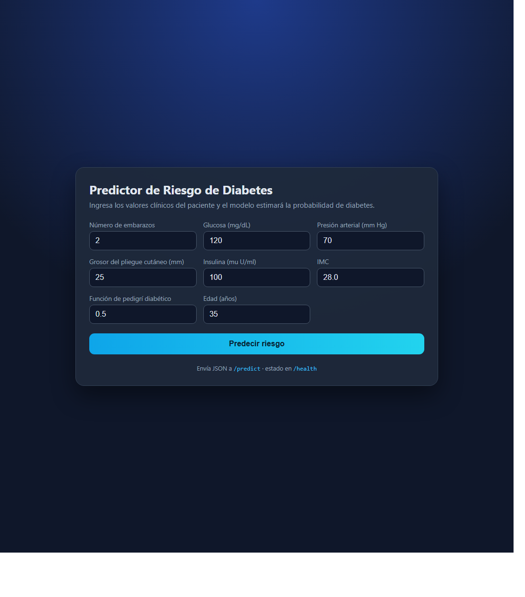
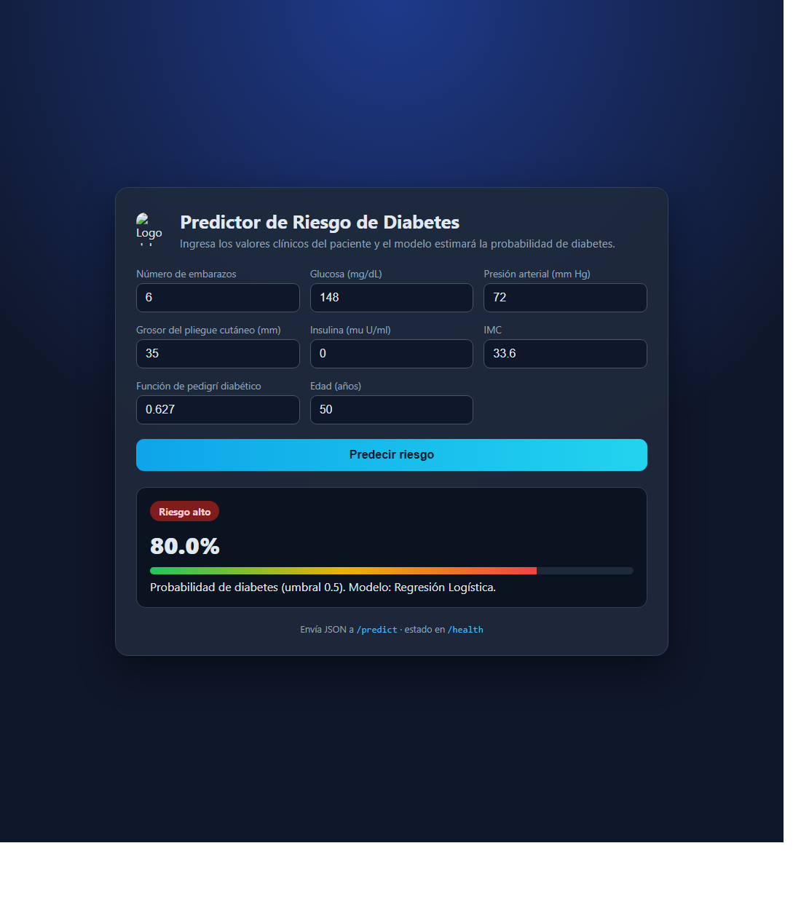
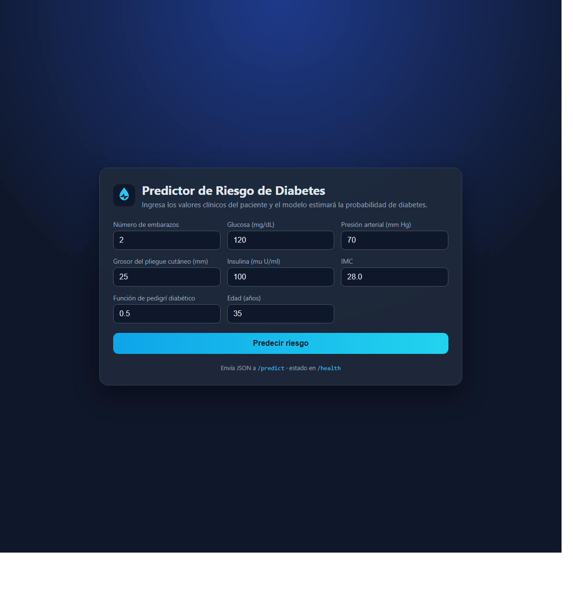

# Predicción de Riesgo de Diabetes

Servicio web de machine learning que estima la probabilidad de que un paciente tenga diabetes a partir de mediciones clínicas rutinarias.

**Servicio en vivo:** <https://diabetes-risk-prediction-sigma.vercel.app>

[](https://www.python.org/)
[](https://scikit-learn.org/)
[](https://flask.palletsprojects.com/)
[](https://www.docker.com/)
[](https://diabetes-risk-prediction-sigma.vercel.app)

---

## 1. Descripción del problema

La diabetes es una enfermedad crónica que afecta a cientos de millones de personas, y muchos casos se diagnostican tarde porque los síntomas iniciales son fáciles de ignorar. Un modelo que marque a los pacientes de alto riesgo usando mediciones clínicas económicas puede ayudar a una clínica a decidir a quién conviene hacerle primero la prueba de sangre de confirmación.

**Objetivo:** predecir la variable binaria `Outcome` (1 = diabetes, 0 = sin diabetes) a partir de 8 características clínicas.

**Cómo se usa la predicción:** el médico llena un pequeño formulario web con los valores del paciente y obtiene de inmediato una probabilidad de riesgo y una etiqueta `riesgo alto` / `riesgo bajo`. Es una **herramienta de tamizaje**, no un diagnóstico médico.

**¿Por qué un modelo de machine learning?** La relación entre glucosa, IMC, edad, insulina y diabetes no es un simple umbral. Un modelo puede combinar todas las mediciones al mismo tiempo y entregar una probabilidad que es más fácil de interpretar que un conjunto de cortes separados.

---

## 2. Dataset

**Base de datos de diabetes de los indios Pima** — originalmente del National Institute of Diabetes and Digestive and Kidney Diseases (NIDDK), distribuida como dataset público.

* Archivo: [`data/diabetes.csv`](data/diabetes.csv)
* Fuente: <https://raw.githubusercontent.com/plotly/datasets/master/diabetes.csv>
* Filas: **768** pacientes (mujeres de ascendencia india Pima, de 21 años o más)
* Variable objetivo: `Outcome` (1 = diabetes, 0 = sin diabetes) — **34.9% de casos positivos**
* Licencia: dominio público / redistribuible libremente con fines educativos

| Característica | Descripción |
|---|---|
| `Pregnancies` | Número de embarazos |
| `Glucose` | Concentración de glucosa en plasma (prueba de tolerancia oral a la glucosa de 2 horas, mg/dL) |
| `BloodPressure` | Presión arterial diastólica (mm Hg) |
| `SkinThickness` | Grosor del pliegue cutáneo del tríceps (mm) |
| `Insulin` | Insulina sérica a las 2 horas (mu U/ml) |
| `BMI` | Índice de masa corporal (kg/m²) |
| `DiabetesPedigreeFunction` | Puntaje de antecedentes familiares de diabetes |
| `Age` | Edad en años |

> **Detalle importante de los datos:** en este dataset un `0` en `Glucose`, `BloodPressure`, `SkinThickness`, `Insulin` o `BMI` **no** significa una medición real, sino *"no medido"*. Esos ceros se reemplazan por `NaN` y se imputan con la mediana del conjunto de entrenamiento dentro del pipeline del modelo. La API sigue la misma convención: envía `0` para un valor que no fue medido.

---

## 3. Resultados

Se compararon tres modelos con validación cruzada estratificada de 5 pliegues (métrica: **ROC AUC**) y se ajustaron sus hiperparámetros con `GridSearchCV`. El conjunto de prueba (20% de los datos, 154 pacientes) nunca se usó durante el entrenamiento ni el ajuste.

| Modelo | Mejores hiperparámetros | ROC AUC (CV) | ROC AUC (prueba) | Exactitud (prueba) | F1 (prueba) |
|---|---|---|---|---|---|
| **Regresión Logística** (seleccionada) | `C=0.1`, `class_weight="balanced"` | **0.8450** | **0.8104** | 0.7078 | 0.6154 |
| Random Forest | `n_estimators=400`, `max_depth=4`, `min_samples_leaf=3` | 0.8389 | 0.7996 | 0.7273 | 0.5435 |
| Gradient Boosting | `n_estimators=100`, `learning_rate=0.05`, `max_depth=2` | 0.8297 | 0.8148 | 0.7208 | 0.5657 |

Se eligió la regresión logística porque obtuvo el mejor puntaje de validación cruzada. Con `class_weight="balanced"` también tiene el mejor **recall** de la clase positiva (0.67), que es la métrica más importante en una herramienta de tamizaje: preferimos una falsa alarma antes que dejar pasar a un paciente enfermo.

> Las métricas completas están en [`model/metrics.json`](model/metrics.json) y reproducidas en [`notebook.ipynb`](notebook.ipynb).

### Capturas de pantalla

| Formulario de entrada (`/`) | Resultado de la predicción (`POST /predict`) |
|---|---|
|  |  |

---

## 4. Estructura del proyecto

```
diabetes-risk-prediction/
├── README.md                  # Este archivo
├── notebook.ipynb             # EDA + comparación de modelos + ajuste + evaluación (ejecutado)
├── train.py                   # Entrena y ajusta los modelos, guarda el pipeline
├── app.py                     # Servicio web Flask (formulario HTML + API JSON)
├── download_data.py           # Vuelve a descargar el dataset (opcional)
├── requirements.txt           # Dependencias del servicio (versiones fijas)
├── requirements-dev.txt       # Dependencias extra para el notebook
├── .python-version            # Versión de Python que usa Vercel
├── Dockerfile                 # Imagen de contenedor para el servicio web
├── data/
│   └── diabetes.csv           # Dataset (incluido en el repo)
└── model/
    ├── diabetes_pipeline.joblib  # Imputador + escalador + clasificador (incluido)
    └── metrics.json              # Métricas de todos los modelos ajustados
```

---

## 5. Cómo ejecutar el proyecto

### 5.1 Crear y activar un entorno virtual

```bash
# Linux / macOS
python -m venv .venv
source .venv/bin/activate
```

```powershell
# Windows (PowerShell)
python -m venv .venv
.venv\Scripts\Activate.ps1
```

### 5.2 Instalar las dependencias

Para ejecutar el servicio (Flask, scikit-learn, pandas):

```bash
pip install -r requirements.txt
```

Para reproducir el notebook (agrega matplotlib y seaborn):

```bash
pip install -r requirements-dev.txt
```

### 5.3 (Opcional) descargar el dataset

El dataset ya está incluido en `data/diabetes.csv`. Para volver a descargarlo desde la fuente original:

```bash
python download_data.py
```

### 5.4 Entrenar el modelo

```bash
python train.py
```

Salida esperada (tarda ~1 minuto):

```
Cargando datos...
Filas: 768 | Características: 8 | Tasa de positivos: 34.90%
Ajustando logistic_regression...
Ajustando random_forest...
Ajustando gradient_boosting...
Mejor modelo: logistic_regression (ROC AUC en CV = 0.8450)
Modelo guardado en:   .../model/diabetes_pipeline.joblib
```

Esto reescribe `model/diabetes_pipeline.joblib` y `model/metrics.json`.

### 5.5 Explorar el notebook

```bash
pip install -r requirements-dev.txt
jupyter notebook notebook.ipynb
```

El notebook ya está ejecutado, así que los gráficos y resultados se ven directamente en GitHub/nbviewer. Vuelve a ejecutar todas las celdas si quieres reproducirlos (`Kernel → Restart & Run All`).

### 5.6 Ejecutar el servicio web localmente

```bash
python app.py
```

Abre **<http://localhost:9696>** en el navegador, o llama a la API JSON:

```bash
curl -X POST http://localhost:9696/predict \
  -H "Content-Type: application/json" \
  -d '{"Pregnancies": 6, "Glucose": 148, "BloodPressure": 72, "SkinThickness": 35,
       "Insulin": 0, "BMI": 33.6, "DiabetesPedigreeFunction": 0.627, "Age": 50}'
```

```json
{
  "prediction": 1,
  "risk_label": "riesgo alto",
  "risk_probability": 0.8005,
  "threshold": 0.5,
  "model": "logistic_regression"
}
```

Equivalente en PowerShell:

```powershell
$body = @{Pregnancies=6; Glucose=148; BloodPressure=72; SkinThickness=35; Insulin=0;
          BMI=33.6; DiabetesPedigreeFunction=0.627; Age=50} | ConvertTo-Json
Invoke-RestMethod -Uri http://localhost:9696/predict -Method Post -Body $body -ContentType "application/json"
```

Verificación de estado:

```bash
curl http://localhost:9696/health
```

---

## 6. Docker

Construir la imagen:

```bash
docker build -t diabetes-risk-prediction .
```

Ejecutar el contenedor (el servicio escucha en el puerto 9696):

```bash
docker run --rm -p 9696:9696 diabetes-risk-prediction
```

Luego abre <http://localhost:9696> o repite la llamada `curl` de arriba.

La imagen solo copia `app.py` y `model/`, así que no incluye el notebook, los datos de entrenamiento ni las dependencias de desarrollo.

---

## 7. Despliegue en la nube (Vercel)

El servicio se despliega **tal cual** en [Vercel](https://vercel.com) con el plan Hobby (gratis y sin tarjeta). Vercel reconoce `app.py` como una aplicación Flask y la ejecuta como función serverless: no hay servidor que se apague por inactividad, solo un arranque en frío de uno o dos segundos en la primera visita.

1. Entra a <https://vercel.com> e inicia sesión con GitHub.
2. Clic en **Add New → Project** e importa el repositorio `diabetes-risk-prediction`.
3. No cambies ninguna opción: Vercel detecta Flask, instala `requirements.txt` y usa Python 3.13 gracias al archivo `.python-version`.
4. Clic en **Deploy** y espera un par de minutos.
5. La URL pública queda como `https://diabetes-risk-prediction-sigma.vercel.app`.

Comprueba que responde:

```bash
curl https://diabetes-risk-prediction-sigma.vercel.app/health
```

```json
{"status": "ok", "model_loaded": true, "model": "Regresión Logística", "features": ["..."]}
```

### Servicio en vivo

**<https://diabetes-risk-prediction-sigma.vercel.app>**

[](https://diabetes-risk-prediction-sigma.vercel.app)

El repositorio también incluye un `Dockerfile`, así que el mismo servicio puede desplegarse en cualquier plataforma de contenedores (Render, Railway, Fly.io, Cloud Run). En ese caso el contenedor escucha en `$PORT` y arranca con `gunicorn app:app`.

---

## 8. Cómo se construyó el modelo (resumen)

1. **EDA** — desbalance de clases, ceros imposibles, distribuciones, diagramas de caja por clase y matriz de correlación.
2. **Limpieza** — los ceros se convierten en `NaN` en las cinco columnas afectadas.
3. **Pipeline** — imputación por mediana + escalado estándar + clasificador, ajustado solo con el conjunto de entrenamiento para evitar fuga de datos.
4. **Selección de modelo** — regresión logística, random forest y gradient boosting comparados con validación cruzada estratificada de 5 pliegues.
5. **Ajuste** — `GridSearchCV` sobre `C`, `class_weight`, profundidad de árboles, número de estimadores y tasa de aprendizaje.
6. **Evaluación** — exactitud, precisión, recall, F1, ROC AUC y matriz de confusión sobre el conjunto de prueba.
7. **Exportación** — `train.py` reproduce el entrenamiento; el pipeline se guarda con `joblib`.
8. **Servicio** — `app.py` (Flask) expone un formulario HTML, una API JSON y un endpoint de salud; `Dockerfile` lo empaqueta.

---

## 9. Limitaciones

* Solo **768 filas**, todas de **mujeres de ascendencia india Pima de 21 años o más**. El modelo no debería aplicarse a otras poblaciones sin reentrenarlo.
* El dataset es antiguo y algunos valores son autoinformados; la columna `Insulin` falta en casi la mitad de las filas.
* El modelo es una **ayuda al tamizaje**. No reemplaza al médico ni a una prueba de laboratorio.
* No se realizó un estudio de calibración, por lo que la probabilidad debe leerse como un puntaje de riesgo relativo y no como una probabilidad clínica exacta.

---

## 10. Autor

**Alvaro Andres Salazar Valdez** — Machine Learning Zoomcamp 2026, proyecto midterm.

Dataset: Pima Indians Diabetes Database (NIDDK), distribuido a través del repositorio de datasets de Plotly.
